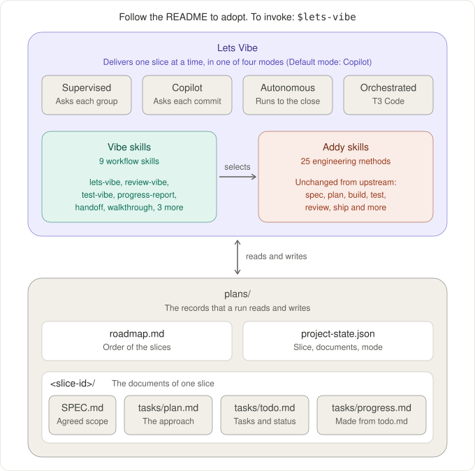

# Lets Vibe

A set of agent skills for Codex and Claude that delivers work in slices. One slice is one agreed outcome: its scope, a plan, the build, the checks, one independent review and a close. You start the workflow with `/lets-vibe` in Claude or `$lets-vibe` in Codex, or with a plain request to start or continue a slice.

This repository is a small pnpm workspace with the skills installed and a sample project ready to build: the website of Teekaapi, a cafe in Melbourne. You can adapt the skills to your own project, or try the workflow on the sample first.



## Two ways to start

### A. Adapt lets-vibe to your project

Open an agent session in your repository and give it this prompt:

```text
Adapt lets-vibe to this project. Take a copy of techakayy/lets-vibe in a throwaway folder outside this repository, read its README.md in full, and follow its section "Adaptation steps" step by step. Do not commit and do not push: I review the changes first.
```

The agent copies the skills, merges the files that you already have, asks you the few questions of those steps, runs the check and reports. When you have accepted the result, the throwaway folder is no longer needed.

### B. Build the sample project

Use this to see the workflow before you bring it into your own repository.

1. Install, and check that the kit is whole:

```sh
pnpm install
pnpm check
```

2. Open an agent session in this folder and type `/lets-vibe supervised` in Claude, or `$lets-vibe supervised` in Codex.

The agent reads the [project pointer](plans/project-state.json), the [roadmap](plans/roadmap.md) and the [site brief](plans/teekaapi-brief.md), and proposes the scope of the first slice. In supervised mode it stops before each group of work and waits for you, so you see each step: specification, plan, build, test, review and close. The site is built in `packages/app`.

## What is inside

| Path | What it is |
|---|---|
| `tooling/agents/plugins/vibe` | Nine workflow skills: `lets-vibe`, `review-vibe`, `test-vibe`, `progress-report`, `handoff`, `walkthrough`, `dependency-upgrade`, `grill-peers`, `roadmap-review` |
| `tooling/agents/plugins/addy` | Addy Osmani's 25 engineering skills, unchanged; Lets Vibe selects from them at each step |
| `tooling/agents/tooling` | The validator, the progress report, the run report and their tests |
| `.agents/skills`, `.claude/skills` | Relative links that let Codex and Claude find the skills |
| `.claude/settings.json` | The setting that stops a skill from starting by itself, and the hook that writes the progress report again |
| `AGENTS.md` | The rules for every session; the skills link to its record rules and rely on its authority rules |
| `package.json`, `pnpm-workspace.yaml` | The workspace: product packages under `packages/`, the agents package, and the roadmap renderer |
| `packages/app` | The sample project: a placeholder that the first slice turns into the Teekaapi site |
| `plans/` | The sample [roadmap](plans/roadmap.md) with its generated [HTML page](plans/roadmap.html) and renderer, the site brief, the project pointer, and the exempt list of the record rules |

The [agents package README](tooling/agents/README.md) explains each skill, why a skill starts only when a person asks, the checks and the two reports. [UPSTREAM.md](tooling/agents/plugins/addy/UPSTREAM.md) records the source of the Addy collection and what was added around it.

## What you need

- Git. The record rules ask Git what is a commit or a branch.
- Node `^22.18.0` or `^24.11.0`. The tooling is TypeScript that Node runs directly.
- pnpm 11.
- A file system with symbolic links. On Windows, turn them on in Git before you clone.

## Adaptation steps

An agent that got the prompt of way A follows these steps; a person can do them by hand. Here the kit is the copy of this repository, the project is the repository that receives the skills, and the owner is the person who asked.

Keep the paths as they are: the links and the tooling expect the agents package at `tooling/agents`, two levels below the root of the project.

1. **Look first.** Look at the branch and the working tree of the project before any change. Work on a new branch. Do not commit and do not push: the owner reviews the changes first.
2. **Copy as they are.** Copy `tooling/agents` (without `node_modules`), `.agents/skills`, `.claude/skills` and `plans/record-rules-exempt.txt` from the kit to the same paths in the project. Use a copy that keeps each symbolic link as a relative link, for example `rsync -a`. If a link arrived as a plain file or folder, make it again as a relative link to `../../tooling/agents/plugins/<plugin>/skills/<name>`. If one of these paths already exists in the project, stop and ask the owner.
3. **Leave the sample in the kit.** Do not copy `packages/app`, `plans/roadmap.md`, `plans/roadmap.html`, `plans/teekaapi-brief.md` or `plans/project-state.json`.
4. **Merge, and overwrite nothing of the owner.**
   - `AGENTS.md`: keep the rules of the project and add the sections of the kit. Where the two disagree, show both to the owner and ask.
   - `CLAUDE.md`, `.claude/CLAUDE.md` or `CLAUDE.local.md`: with one of them, Claude stops reading `AGENTS.md`. Move its rules into `AGENTS.md`, and ask the owner before the file is removed.
   - `.claude/settings.json`: add the hook and each `skillOverrides` entry of the kit.
   - `.gitignore`: add the lines of the kit.
5. **The workspace.** Ask the owner whether the project gets the workspace layout of the kit: a root `package.json`, a `pnpm-workspace.yaml`, and one folder for each package under `packages/`. On a yes where the project has none, set it up from the two files of the kit, and move no code of the project without asking. Where the project already is a pnpm workspace, add `tooling/agents` to its packages. The agents package needs no workspace: without one it installs by itself and writes its own lock file, whatever language or package manager the project uses.
6. **The roadmap page.** Ask the owner whether the project gets an HTML page of its roadmap. On a yes, copy `plans/render-roadmap.mjs` and `plans/package.json`, and add the two `roadmap` scripts of the kit's root `package.json`.
7. **The project paragraph.** Write the first paragraph under “Scope and context” in `AGENTS.md` from what the project holds, and show it to the owner.
8. **The slice identifiers.** Ask the owner for the form of the slice identifiers and write it in `tooling/agents/records.json`. Set it to null if the owner has none yet. [Make it yours](#make-it-yours) says more about this setting and the others.
9. **Install and check.** Use a Node version from [What you need](#what-you-need):

```sh
pnpm --dir tooling/agents install
pnpm --dir tooling/agents run check
```

   If the record rules refuse files that the project already had, change none of them: list them and ask the owner which to add to `plans/record-rules-exempt.txt`.

10. **Report.** Say what was copied, what was merged, the result of the check, and what is left for the owner to decide. The owner opens a new session in each host, so that it sees the skills.

## Make it yours

- **`AGENTS.md`.** Replace the first paragraph under “Scope and context”, which describes the sample, with a description of your project. Read the remaining rules and change what does not fit how you work; the skills need the “Records” section and the rules on authority in “Collaboration and Git”.
- **A workspace.** To give your project the layout of the kit, keep the root `package.json` and `pnpm-workspace.yaml` and put each package of your product in its own folder under `packages/`.
- **Slice numbers.** [records.json](tooling/agents/records.json) gives the form of the slice identifiers, so that the record rules can keep them inside `plans/`. It holds the form that the sample roadmap uses: the letter S, two digits and an optional sub-slice number. Change it to your own form, or set it to null to turn that rule off. Keep the form narrow: a broad one, such as any letter with two digits, also matches ordinary text, in your code and in the Addy skills.
- **Outside commands.** [run-report.json](tooling/agents/run-report.json) holds the patterns of the commands that the run report lists as outside commands. It starts with a push, a pull request or release, and a package publication. Add your own deployment commands.
- **Older material.** The record rules refuse a file that names a commit or a branch of your repository. List a file from before the rules, such as a changelog, in `plans/record-rules-exempt.txt`.
- **Roadmap and reading map.** Both are optional. A roadmap in `plans/` lets Lets Vibe propose the next slice; the sample roadmap shows the form, and `pnpm roadmap` writes its HTML page. A reading map names your architecture documents, your foundation and the peer projects that you compare with; without one, the workflow skips that preparation.

## The first slice

Ask for a slice in plain words or type the skill name. Lets Vibe agrees the scope with you and then creates what it needs:

```text
plans/project-state.json      the pointer: the selected slice, its documents, the execution mode
plans/<slice-id>/SPEC.md
plans/<slice-id>/tasks/plan.md
plans/<slice-id>/tasks/todo.md
plans/<slice-id>/tasks/progress.md   generated from todo.md
```

Without a word for the mode, the execution mode is copilot: the agent works through a deliverable and stops for your review before each commit. The [execution-mode rules](tooling/agents/plugins/vibe/skills/lets-vibe/references/contract-core.md#execution-modes) describe the four modes.

**Orchestrated mode needs the right application.** In that mode one session starts and steers another, so the application must let a session start a separate top-level conversation, set its model and permissions, and send it messages; [the host](tooling/agents/plugins/vibe/skills/lets-vibe/references/orchestration.md#the-host) gives the full list. Use T3 Code (Nightly), version `0.0.46-nightly.20261010` or later; that is the version it was run on. The other three modes work in any Claude or Codex session.

When the first slice has started, add the freshness check of the saved report to the `check` script of the root `package.json` and to your CI job:

```sh
pnpm --dir tooling/agents run progress --check
```

## Licence

The workflow skills and the tooling are under the MIT [licence](LICENSE). The Addy collection is under the MIT [licence](tooling/agents/plugins/addy/LICENSE) of its author.
